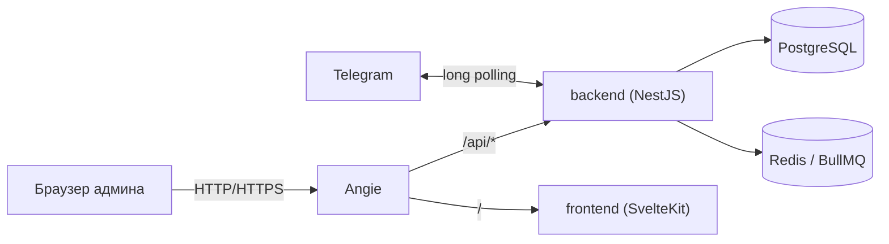
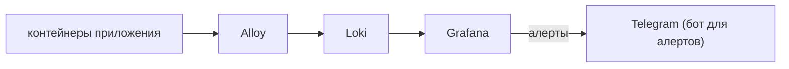
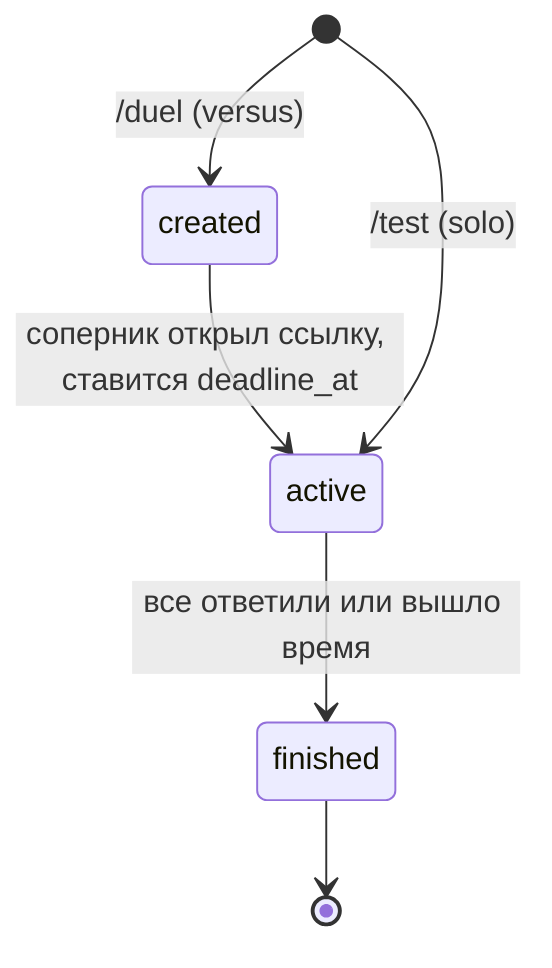

# Blind Battle (Quizzle)

Telegram-бот для асинхронных квиз-дуэлей 1 на 1. Оба игрока отвечают на одни и те же вопросы, пока не истечёт общий таймер, но **не видят ответов друг друга до конца игры**. Играть одновременно не нужно: дуэль стартует, когда второй игрок открывает ссылку-приглашение.

Для авторов квизов есть админ-API (сессии, CRUD квизов, публикация) и режим **тестовой игры в одиночку** прямо в боте. Приложение разворачивается одной командой: за Angie стоят backend (NestJS) и frontend (SvelteKit), рядом отдельным проектом живёт мониторинг (Loki, Grafana, алерты в Telegram).

## Содержание

- [Как играть](#как-играть)
- [Архитектура](#архитектура)
- [Структура репозитория](#структура-репозитория)
- [Быстрый старт](#быстрый-старт)
- [Конфигурация](#конфигурация)
- [Команды Task](#команды-task)
- [API](#api)
- [База данных](#база-данных)
- [Прод и HTTPS](#прод-и-https)
- [Мониторинг и алерты](#мониторинг-и-алерты)
- [Тесты](#тесты)
- [Частые проблемы](#частые-проблемы)
- [Статус и планы](#статус-и-планы)

## Как играть

| Команда | Что делает |
|---|---|
| `/start` | Регистрация. Один раз нужно подтвердить свой номер телефона (кнопка «Поделиться номером») |
| `/duel` | Создаёт дуэль и выдаёт ссылку `t.me/<bot>?start=<token>` для соперника |
| `/start <token>` | Соперник принимает вызов: запускается общий таймер, оба получают первый вопрос |
| `/test` | Только для админов (`ADMINS_IDS`): тестовая игра в одиночку по любому квизу, в том числе по неопубликованному |

Правила:

- Квиз выбирается случайно среди опубликованных; на весь квиз один таймер (`timeLimitSec`).
- В каждом вопросе ровно один верный ответ. Очки равны числу верных ответов, вопрос без ответа считается неверным.
- Кто закончил раньше, ждёт соперника или конца таймера. После этого обоим приходит результат: победа, поражение или ничья.
- Тестовая игра админа в статистику и рейтинг не попадает: у неё отдельное событие `game.solo_finished`.

## Архитектура



Мониторинг работает отдельным compose-проектом и читает логи через Docker API:



### Стек

- **NestJS** (TypeScript), модульный монолит
- **PostgreSQL** + **TypeORM** (схема задаётся SQL-скриптами, `DB_SYNCHRONIZE=false`)
- **Redis** + **BullMQ**: отложенное завершение игры по таймеру
- **nestjs-telegraf**: бот; **express-session** + **argon2**: сессии и пароли админов
- **class-validator**, **@nestjs/swagger**, **@nestjs/event-emitter**
- **SvelteKit** (adapter-node): админка
- **Angie**: реверс-прокси, HTTPS через встроенный ACME
- **Grafana Loki + Alloy + Grafana**: логи и алерты
- **Docker Compose** + **Task**: запуск и операции
- **Vitest** (+ SWC): юнит-тесты

### Модули backend

```
backend/src/
  common/            декораторы, фильтры, интерсепторы, TypeOrmRepository, события (common/events)
  config/
  infrastructure/    database, bullmq, cache, event (EventService), telegraf
  modules/
    admin/           админ-API: auth, admins, quiz (владелец квизов), facades, controllers
    game/            домен игры: entity, repository, service, logic, processor (BullMQ), scheduler
    user/            пользователи Telegram
    rating/          статистика (в разработке)
    notification/    уведомления (в разработке)
    telegram/        только транспорт: updates, listeners, keyboards, utils
    health/
```

Основные принципы:

- **`game` не знает про `admin`.** Квизы он получает через порт `IQuizPort` (токен `QUIZ_PORT`). Реализация (`QuizFacade`) живёт в `admin` и сейчас ходит в БД напрямую. При выносе админки в отдельный сервис её заменит HTTP/gRPC-клиент того же порта, а `game` не изменится.
- **Снапшот вопросов.** При старте игры квиз копируется в `games.quiz` (jsonb), поэтому правка или скрытие квиза не ломает идущие игры.
- **DTO на границах модулей.** Внутри модуля работают сущности, наружу уходят DTO (`entity.getPublic()`). Флаги правильных ответов никогда не покидают `game`.
- **События** типизированы в `common/events` (`EventMap`) и отправляются через `EventService`:

  | Событие | Кто слушает |
  |---|---|
  | `game.started` | `telegram`: автору уходит первый вопрос |
  | `game.finished` | `telegram`: результат обоим; `rating`: статистика (в разработке) |
  | `game.solo_finished` | `telegram`: результат тестовой игры |

- **`telegram` не содержит игровой логики**: хендлеры зовут `GameService` и `UserService`, а ошибки доменных сервисов превращаются в понятные сообщения фильтром `TelegramExceptionFilter`.

### Жизненный цикл игры



## Структура репозитория

```
.
├── Taskfile.yaml
├── angie/
│   ├── angie.conf                  основной конфиг
│   ├── snippets/                   proxy.conf, security.conf, locations.conf
│   └── sites/
│       ├── dev/site.conf           HTTP
│       └── prod/site.conf          HTTPS + Let's Encrypt (ACME)
├── backend/                        NestJS, Dockerfile
├── frontend/                       SvelteKit, Dockerfile
├── monitoring/
│   ├── loki/loki-config.yaml
│   ├── alloy/config.alloy
│   └── grafana/provisioning/       datasources, alerting (контакт, политики, правила)
└── deploy/
    ├── docker-compose.yaml         приложение: angie, backend, frontend, postgres, redis
    ├── docker-compose.dev.yaml     dev-override: демо-данные, порты БД и Redis на localhost
    ├── docker-compose.monitoring.yaml
    ├── env/                        .env.backend, .env.frontend, .env.postgres, .env.deploy, .env.monitoring
    └── scripts/                    SQL: 01-init, 02-base-data, 03-quize-data, 04-upd-table
```

В репозитории лежат только `deploy/env/.env.*.example` с примерными значениями, реальные файлы в `.gitignore`.

## Быстрый старт

Нужны: Docker с Compose **2.24+** (несколько `--env-file`) и [Task](https://taskfile.dev).

```bash
task env:init      # создать env-файлы из примеров и заполнить их (см. «Конфигурация»)
task config        # проверить, что compose собирается без ошибок подстановки
task angie:check   # проверить конфиг Angie
task up:all        # приложение + мониторинг (dev)
task ps:all        # статус всех сервисов
```

После старта:

| Что | Адрес |
|---|---|
| Приложение | `http://localhost:8080` |
| Swagger | `http://localhost:8080/api/swagger` (если `SWAGGER_ENABLE=true`) |
| Grafana | `http://localhost:3001` (только localhost, логин `admin`) |

Бот работает через long polling: напиши ему `/start`. Чтобы пользоваться `/test`, добавь свой Telegram ID в `ADMINS_IDS`.

## Команды Task

Режим выбирается переменной `STACK`: по умолчанию `dev` (с dev-override), на сервере `STACK=prod`.

| Команда | Что делает |
|---|---|
| `task env:init` | Создаёт env-файлы из `*.example`, существующие не трогает |
| `task up` / `task down` | Приложение: собрать и запустить / остановить |
| `task up:all` / `task down:all` | Приложение и мониторинг вместе |
| `task ps` / `task ps:all` | Статус и healthcheck |
| `task logs -- backend` | Логи сервиса |
| `task restart -- backend` | Перезапустить сервис |
| `task build -- backend` | Пересобрать образ |
| `task config` | Итоговый compose с подстановкой переменных |
| `task clean` | Остановить и **удалить тома** (БД, Redis, сертификаты) |
| `task angie:check` / `task angie:reload` | Проверить конфиг Angie / перечитать без простоя |
| `task db:psql` | psql в контейнере Postgres |
| `task db:apply -- deploy/scripts/04-upd-table.sql` | Применить SQL-файл |
| `task mon:up` / `mon:down` / `mon:ps` / `mon:logs` / `mon:restart` | Управление мониторингом |

## Прод и HTTPS

В Angie маршрутизация такая: `/api/*` идёт в backend, всё остальное во frontend, `/healthz` отвечает сам прокси. На уровне Angie включены: JSON access-лог, лимиты запросов (логин и API), заголовки безопасности, динамический DNS upstream'ов (`resolve`), сжатие. Сертификаты Let's Encrypt выпускает встроенный ACME-клиент.

1. Направь A-запись домена на сервер, открой порты 80 и 443.
2. В `deploy/env/.env.deploy`: `ANGIE_SITE=prod`, `HTTP_PORT=80`.
3. В `.env.backend` и `.env.frontend`: публичный адрес `https://example.com` (`APP_BASE_URL`, `ALLOWED_ORIGIN`, `ORIGIN`), сильный `SECRET`, `SWAGGER_ENABLE=false`.
4. В `angie/sites/prod/site.conf` замени `example.com` на свой домен. Первый запуск сделай на staging-сервере Let's Encrypt (строка закомментирована в файле), убедись по `task logs -- angie`, что сертификат выдаётся, затем переключись на боевой и перезапусти Angie.
5. `task up:all STACK=prod`.

Важно:

- Бот работает через long polling, поэтому у `backend` должна быть **ровно одна реплика**, иначе Telegram вернёт конфликт `getUpdates`.
- Postgres и Redis находятся во внутренней сети и снаружи недоступны. Grafana слушает только `127.0.0.1`: на сервере открывай через SSH-туннель `ssh -L 3001:127.0.0.1:3001 user@server`.
- Сменять пароль админа и секреты нужно до первого публичного запуска.

## Мониторинг и алерты

Отдельный compose-проект `blind-battle-monitoring` с лимитами CPU и памяти. Перезапуск мониторинга приложение не затрагивает.

- **Alloy** читает логи контейнеров приложения через Docker API и отправляет в Loki. Лейблы: `service`, `container`, `env`, у backend ещё `level`. Backend пишет JSON-логи, Angie отдаёт JSON access-лог.
- **Loki** хранит логи 14 дней, наружу не публикуется.
- **Grafana** показывает логи (Explore) и шлёт алерты в Telegram через отдельного бота.

Алерты (папка «Blind Battle» в Grafana):

| Алерт | Условие |
|---|---|
| Ошибки в логах backend | больше 5 за 5 минут |
| Всплеск 5xx на входе | больше 5 за 5 минут |
| Upstream недоступен | Angie не может достучаться до backend или frontend |
| Сбои завершения игр | ошибки подметальщика, таймера или событий игры |
| Backend перезапускается | больше 2 стартов за 10 минут |

Проверка: Grafana, Alerting, Contact points, `telegram`, Test. Если Grafana лежит вместе с сервером, алертов не будет, поэтому добавь внешнюю проверку `/healthz` (UptimeRobot или аналог).

Alloy читает Docker-сокет только на чтение, но для прода лучше поставить `docker-socket-proxy`. В логах Angie есть IP клиентов, учитывай это при настройке срока хранения.

## Статус и планы

Готово: админ-API с Swagger, дуэли, тестовый solo-режим для админов, таймеры и подметальщик, Telegram-бот, реверс-прокси Angie с HTTPS, мониторинг с алертами, Task-команды для запуска.

В планах:

- Слушатель `rating`: обновление `statistic_users` и `statistic_games` по `game.finished` (`INSERT ... ON CONFLICT`), затем ELO и лидерборд
- Воркеры уведомлений и напоминания сопернику («buddy system»)
- Svelte-админка (редактор вопросов, аналитика сложности)
- Интеграционные тесты на реальном Postgres: двойной тап, ответ после дедлайна, гонка завершения, solo

Известные ограничения MVP:

- Токен приглашения теряется, если игрок открыл ссылку до подтверждения номера: после подтверждения нужно открыть ссылку ещё раз.
- Событие `game.finished` уходит после коммита, при падении процесса ровно между ними статистика игры не обновится (решение: outbox).
- Ничья при равном счёте не разрешается по скорости ответов: время ответов не хранится.
- Игры в статусе `created`, к которым никто не присоединился, не удаляются.
