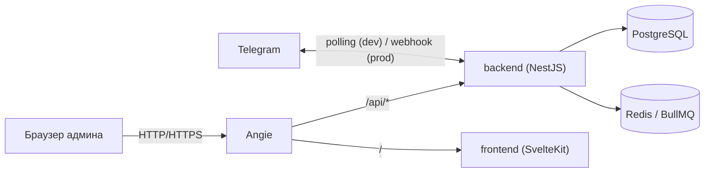
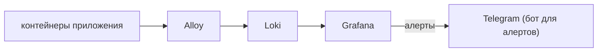

# Blind Battle (Quizzle)

Telegram-бот для асинхронных квиз-дуэлей 1 на 1. Оба игрока отвечают на одни и те же вопросы, пока не истечёт общий таймер, но **не видят ответов друг друга до конца игры**. Играть одновременно не нужно: дуэль стартует, когда второй игрок открывает ссылку-приглашение.

Для авторов квизов есть админ-API (сессии, CRUD квизов, публикация) и режим **тестовой игры в одиночку** прямо в боте. Приложение разворачивается одной командой: за Angie стоят backend (NestJS) и frontend (SvelteKit), рядом отдельным проектом живёт мониторинг (Loki, Grafana, алерты в Telegram).

## Содержание

- [Как играть](#как-играть)
- [Архитектура](#архитектура)
- [Структура репозитория](#структура-репозитория)
- [Быстрый старт](#быстрый-старт)
- [Конфигурация](#конфигурация)
- [Команды Task](#команды-task)
- [Мониторинг и алерты](#мониторинг-и-алерты)

## Как играть

| Команда | Что делает |
|---|---|
| `/start` | Регистрация. Один раз нужно подтвердить свой номер телефона (кнопка «Поделиться номером») |
| `/duel` | Создаёт дуэль и выдаёт ссылку `t.me/<bot>?start=<token>` для соперника |
| `/topics` | Показывает темы клавиатурой; квиз выбирается случайно внутри выбранной темы |
| `/stats` | Показывает статистику игрока: победы, поражения, ничьи |
| `/start <token>` | Соперник принимает вызов: запускается общий таймер, оба получают первый вопрос |
| `/test` | Только для админов (`ADMINS_IDS`): тестовая игра в одиночку по любому квизу, в том числе по неопубликованному |

Правила:

- Квиз выбирается случайно среди опубликованных; на весь квиз один таймер (`timeLimitSec`).
- Квиз привязан к одной теме; в игры попадают только опубликованные темы и квизы. `/topics` выбирает тему, а квиз — случайно внутри неё.
- В каждом вопросе ровно один верный ответ. Очки равны числу верных ответов, вопрос без ответа считается неверным.
- Как только оба игрока ответили на все вопросы, игра завершается сразу, не дожидаясь таймера. После этого обоим приходит результат: победа, поражение или ничья.
- Тестовая игра админа в статистику и рейтинг не попадает: у неё отдельное событие `game.solo_finished`.

## Архитектура



Мониторинг работает отдельным compose-проектом и читает логи через Docker API:



### Стек

- **NestJS** (TypeScript), модульный монолит
- **PostgreSQL** + **TypeORM** (схема задаётся SQL-скриптами, `DB_SYNCHRONIZE=false`)
- **Redis** + **BullMQ**: отложенное завершение игры по таймеру
- **nestjs-telegraf**: бот (long polling в dev, webhook в prod); **express-session** + **argon2**: сессии и пароли админов
- **class-validator**, **@nestjs/swagger**, **@nestjs/event-emitter**
- **SvelteKit** (adapter-node): админка
- **Angie**: реверс-прокси, HTTPS через встроенный ACME
- **Grafana Loki + Alloy + Grafana**: логи и алерты
- **Docker Compose** + **Task**: запуск и операции
- **Vitest** (+ `vite-tsconfig-paths`): юнит-тесты

## Структура репозитория

```
.
├── Taskfile.yaml
├── angie/
│   ├── angie.conf                  основной конфиг
│   ├── snippets/                   proxy.conf, security.conf, locations.conf
│   └── sites/
│       ├── dev/site.conf           HTTP
│       └── prod/site.conf          HTTPS + Let's Encrypt (ACME)
├── backend/                        NestJS, Dockerfile
├── frontend/                       SvelteKit, Dockerfile
├── monitoring/
│   ├── loki/loki-config.yaml
│   ├── alloy/config.alloy
│   └── grafana/provisioning/       datasources, alerting (контакт, политики, правила)
└── deploy/
    ├── docker-compose.yaml         приложение: angie, backend, frontend, postgres, redis
    ├── docker-compose.dev.yaml     dev-override: демо-данные, порты БД и Redis на localhost
    ├── docker-compose.test.yaml    изолированный Postgres для e2e
    ├── env/                        
    └── scripts/                    
```

## Быстрый старт

Нужны: Docker с Compose **2.24+** (несколько `--env-file`) и [Task](https://taskfile.dev).

```bash
task env:init      # создать env-файлы из примеров и заполнить их (см. «Конфигурация»)
task config        # проверить, что compose собирается без ошибок подстановки
task angie:check   # проверить конфиг Angie
task up:all        # приложение + мониторинг (dev)
task ps:all        # статус всех сервисов
```

После старта:

| Что | Адрес |
|---|---|
| Приложение | `http://localhost:8080` |
| Swagger | `http://localhost:8080/api/swagger` (если `SWAGGER_ENABLE=true`) |
| Grafana | `http://localhost:3001` (только localhost, логин `admin`) |

В dev бот работает через long polling (`TELEGRAM_MODE=polling`): напиши ему `/start`. Чтобы пользоваться `/test`, добавь свой Telegram ID в `ADMINS_IDS`.

## Команды Task

Режим выбирается переменной `STACK`: по умолчанию `dev` (с dev-override), на сервере `STACK=prod`.

| Команда | Что делает |
|---|---|
| `task env:init` | Создаёт env-файлы из `*.example`, существующие не трогает |
| `task up` / `task down` | Приложение: собрать и запустить / остановить |
| `task up:all` / `task down:all` | Приложение и мониторинг вместе |
| `task ps` / `task ps:all` | Статус и healthcheck |
| `task logs -- backend` | Логи сервиса |
| `task restart -- backend` | Перезапустить сервис |
| `task build -- backend` | Пересобрать образ |
| `task config` | Итоговый compose с подстановкой переменных |
| `task clean` | Остановить и **удалить тома** (БД, Redis, сертификаты) |
| `task angie:check` / `task angie:reload` | Проверить конфиг Angie / перечитать без простоя |
| `task db:psql` | psql в контейнере Postgres |
| `task db:apply -- deploy/scripts/04-upd-table.sql` | Применить SQL-файл |
| `task mon:up` / `mon:down` / `mon:ps` / `mon:logs` / `mon:restart` | Управление мониторингом |

## Мониторинг и алерты

Отдельный compose-проект `blind-battle-monitoring` с лимитами CPU и памяти. Перезапуск мониторинга приложение не затрагивает.

- **Alloy** читает логи контейнеров приложения через Docker API и отправляет в Loki. Лейблы: `service`, `container`, `env`, у backend ещё `level`. Backend пишет JSON-логи, Angie отдаёт JSON access-лог.
- **Loki** хранит логи 14 дней, наружу не публикуется.
- **Grafana** показывает логи (Explore) и шлёт алерты в Telegram через отдельного бота.

| Алерт | Условие |
|---|---|
| Ошибки в логах backend | больше 5 за 5 минут |
| Всплеск 5xx на входе | больше 5 за 5 минут |
| Upstream недоступен | Angie не может достучаться до backend или frontend |
| Сбои завершения игр | ошибки подметальщика, таймера или событий игры |
| Backend перезапускается | больше 2 стартов за 10 минут |
