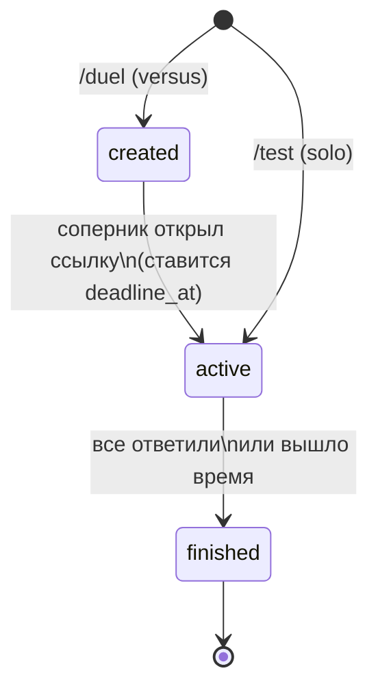

# Blind Battle (Quizzle)

Telegram-бот для асинхронных квиз-дуэлей 1 на 1. Оба игрока отвечают на одни и те же вопросы, пока не истечёт общий таймер, но **не видят ответов друг друга до конца игры**. Соперникам не нужно быть онлайн одновременно: игра стартует, когда второй игрок открывает ссылку-приглашение.

Для авторов квизов есть админ-API (сессии, CRUD квизов, публикация) и режим **тестовой игры в одиночку** прямо в боте.

## Содержание

- [Как играть](#как-играть)
- [Стек](#стек)
- [Архитектура](#архитектура)
- [Надёжность игры](#надёжность-игры)
- [База данных](#база-данных)
- [Быстрый старт](#быстрый-старт)
- [Конфигурация](#конфигурация)
- [Админ-API](#админ-api)
- [Тесты](#тесты)
- [Статус и планы](#статус-и-планы)

## Как играть

| Команда | Что делает |
|---|---|
| `/start` | Регистрация. Нужно один раз подтвердить свой номер телефона (кнопка «Поделиться номером») |
| `/duel` | Создаёт дуэль и выдаёт ссылку `t.me/<bot>?start=<token>` для соперника |
| `/topics` | Показывает темы клавиатурой; квиз выбирается случайно внутри выбранной темы |
| `/stats` | Показывает статистику игрока: победы, поражения, ничьи |
| `/start <token>` | Соперник принимает вызов, запускается общий таймер, оба получают первый вопрос |
| `/test` | Только для админов: тестовая игра в одиночку по любому квизу, в том числе неопубликованному |

Правила:

- Квиз выбирается случайно среди опубликованных; на весь квиз один таймер (`timeLimitSec`).
- Квиз привязан к одной теме; `/topics` выбирает тему, а квиз — случайно внутри неё.
- В каждом вопросе ровно один верный ответ. Очки = число верных ответов; вопросы без ответа считаются неверными.
- Как только оба игрока ответили на все вопросы, игра завершается сразу, не дожидаясь таймера. Затем обоим приходит результат (победа, поражение, ничья).
- Тестовая игра админа не попадает в статистику и в рейтинг: у неё отдельное событие `game.solo_finished`.

## Стек

- **NestJS** (модульный монолит), TypeScript
- **PostgreSQL** + **TypeORM** (схема задаётся SQL-скриптами, `synchronize: false`)
- **Redis** + **BullMQ**: отложенная задача завершения игры по таймеру
- **nestjs-telegraf** (Telegraf): бот, long polling в dev и webhook в prod
- **express-session** + **argon2**: сессии и пароли админов
- **class-validator / class-transformer**, **@nestjs/swagger**
- **@nestjs/event-emitter**: события между модулями
- **Vitest** (+ `vite-tsconfig-paths`): юнит-тесты

Админка вынесена в `../frontend` (SvelteKit); здесь остаётся админ-API.

## Архитектура

```
backend/src/
  common/              декораторы, фильтры, интерсепторы, TypeOrmRepository, события (common/events)
  config/
  infrastructure/      database, bullmq, cache, event (EventService), telegraf
  modules/
    admin/             админ-API: auth, admins, quiz, tag, facades, controllers
    game/              домен игры: entity, repository, service, logic, processor (BullMQ), scheduler
    user/              пользователи Telegram
    statistic/         статистика игр и игроков
    notification/      уведомления (в разработке)
    telegram/          только транспорт: updates, listeners, keyboards, utils
    health/
```

### Жизненный цикл игры



## Надёжность игры

Источник истины по времени это колонка `deadline_at`, а не очередь. Все критичные операции атомарные:

- **Вход соперника**: один `UPDATE ... WHERE status='created' AND rival_id IS NULL AND author_id <> :user`. Нельзя занять чужую игру или сыграть с собой.
- **Приём ответа**: один `UPDATE` с `array_append` и условиями `status='active' AND deadline_at > now() AND cardinality(answers) = :questionIndex`. Двойной тап, повтор callback и ответ после дедлайна просто не проходят.
- **Завершение** идемпотентно: транзакция с `SELECT ... FOR UPDATE`, повторный вызов ничего не делает. Если все ответили на все вопросы, игра закрывается сразу, не дожидаясь таймера. Дополнительные источники: последний ответ, отложенная задача BullMQ (`jobId = finish-<gameId>`) и cron-подметальщик (раз в минуту; ищет истёкшие и полностью отвеченные игры — страховка на случай падения Redis или рестарта).
- **События** отправляются после коммита.

## База данных

Схема создаётся SQL-скриптами из `docker-entrypoint-initdb.d` при первом старте контейнера Postgres:

| Скрипт | Содержимое |
|---|---|
| `01-init.sql` | Таблицы, enum-типы, индексы, триггер `updated_at` |
| `02-base-data.sql` | Технический `seed-admin` для демо-квизов; вход невозможен. Реальный первый админ — из `DEFAULT_ADMIN_*` |
| `03-quiz-data.sql` | Два демо-квиза (TypeScript, Postgres) |
| `04-upd-table.sql` | Режим `solo`, CHECK-ограничения. Идемпотентный |
| `05-fix-admin-password.sql` | Заменяет legacy bcrypt-хеш дефолтного админа на argon2. Идемпотентный |
| `06-tags.sql` | Таблица `tags`, `quizzes.tag_id`, сид тегов, FK/индексы. Идемпотентный |
| `07-reset-admin-password.sql` | Только dev/staging: сбрасывает старый seed-хеш `admin` на пароль `admin12345` |
| `08-user-pending-invite.sql` | Колонка `users.pending_invite_token`: ссылка не теряется до подтверждения телефона |

Таблицы: `admins`, `users`, `quizzes`, `tags`, `games`, `notifications`, `statistic_users`, `statistic_games`.

Важно: скрипты из `initdb.d` выполняются только на **пустом томе**. На существующей базе новые скрипты применяются вручную:

```bash
task db:apply -- deploy/scripts/05-fix-admin-password.sql
```

Сущности подключаются по маске `**/*.entity.{ts,js}` в конфиге подключения.

## Быстрый старт

Требования: Node.js, Docker (Postgres и Redis).

```bash
# 1. зависимости
cd backend
npm install

# 2. Postgres и Redis (из корня репозитория; схема создастся скриптами initdb.d)
cd ..
task dev

# 3. переменные окружения
cd backend
cp .env.example .env     # заполнить, см. ниже

# 4. запуск
npm run start:dev
```

После старта:

- Swagger: `http://localhost:<порт>/api/swagger` (JSON: `/api/swagger/json`), включается `SWAGGER_ENABLE=true`
- Бот в dev работает через long polling (`TELEGRAM_MODE=polling`): напиши ему `/start`

## Конфигурация

### `deploy/env/.env.backend`

| Переменная | Пример | Описание |
|---|---|---|
| `NODE_ENV` | `production` | Должно совпадать с тем, что принимает `src/config` |
| `TZ` | `Europe/Moscow` | Регистр важен на Linux |
| `ALLOWED_ORIGIN`, `CREDENTIALS` | `http://localhost:8080`, `true` | CORS; за Angie всё same-origin |
| `SECRET`, `MAX_AGE` | `change-me…`, `36000` | Сессии (`openssl rand -hex 32`) |
| `DEFAULT_ADMIN_LOGIN`, `DEFAULT_ADMIN_PASSWORD` | `admin`, `change-me-now` | Первый админ создаётся при старте, если логина ещё нет; существующий пароль не перезаписывается |
| `APP_NAME`, `APP_PORT`, `APP_LOCALE` | `blind-battle`, `3000`, `ru` | В Docker порт фиксирован: `3000` |
| `APP_BASE_URL` | `http://localhost:8080` | Публичный адрес; `https://` включает secure-cookie и обязателен для webhook |
| `APP_GLOBAL_PREFIX` | `api` | Префикс маршрутов |
| `APP_GLOBAL_DEFAULT_API_VERSION` | `1` | Версия по умолчанию, маршруты вида `/api/v1/...` |
| `SWAGGER_ENABLE`, `SWAGGER_CREATE_FILE` | `true`, `false` | В проде `SWAGGER_ENABLE=false` |
| `SWAGGER_PATH` | `api/swagger` | Должен быть под `/api`, иначе Angie отправит путь во frontend |
| `DB_TYPE`, `DB_SYNCHRONIZE` | `postgres`, `false` | Схема только через SQL-скрипты |
| `DB_HOST`, `DB_PORT`, `DB_USERNAME`, `DB_PASSWORD`, `DB_DATABASE` | `localhost`, `5432`, … | В Docker хост и порт задаёт compose, креды берутся из `.env.postgres` |
| `BULLMQ_HOST`, `BULLMQ_PORT` | `localhost`, `6379` | В Docker переопределяются на `redis:6379` |
| `TOKEN` | `123456789:AA…` | Токен игрового бота от @BotFather |
| `ADMINS_IDS` | `111111111,222222222` | Telegram ID админов (команда `/test`) |
| `TELEGRAM_MODE` | `polling` | `polling` для dev, `webhook` для prod |
| `TELEGRAM_WEBHOOK_SECRET` | пусто | Только для webhook: `openssl rand -hex 32`; Telegram присылает его в заголовке |

Если в существующей БД остался старый seed-админ `admin`, backend при старте заменит его
хеш на `DEFAULT_ADMIN_PASSWORD` (только если хеш совпадает с известным старым seed).
Ручной сброс для dev/staging: `task db:apply -- deploy/scripts/07-reset-admin-password.sql`.

### Webhook (prod)

В webhook-режиме backend не запускает long polling, а принимает `POST /api/telegram/webhook`.
На старте он вызывает `setWebhook` для `APP_BASE_URL` с `TELEGRAM_WEBHOOK_SECRET`; секрет
проверяется по заголовку `X-Telegram-Bot-Api-Secret-Token`. Требуется `APP_BASE_URL` с `https://`.
Для отката поставь `TELEGRAM_MODE=polling` и перезапусти backend — Telegraf удалит webhook сам.

## Админ-API

Авторизация по сессионной cookie: сначала `POST /admin/login`, дальше браузер отправляет cookie сам. 
Все ответы приходят в конверте `{ status, data, timestamp, query }`, 
ошибки в виде `{ status, errors: { message, details }, timestamp, path }`.

| Метод | Путь | Описание |
|---|---|---|
| `POST` | `/admin/login` | Вход (публичный) |
| `POST` | `/admin/logout` | Выход |
| `GET` | `/admin/me` | Текущий админ |
| `PATCH` | `/admin/upd-pass` | Смена пароля |
| `POST` | `/admin/new-admin` | Создать админа |
| `POST` | `/tag` | Создать тег (неопубликованный) |
| `GET` | `/tag/all?page=&limit=&isPublished=` | Список тегов |
| `GET` | `/tag/:id` | Тег по ID |
| `PATCH` | `/tag/:id` | Переименовать тег |
| `PATCH` | `/tag/:id/publish` | Опубликовать/снять тег; при снятии квизы тоже становятся черновиками |
| `DELETE` | `/tag/:id` | Мягко удалить тег и снять связанные квизы с публикации |
| `POST` | `/quiz` | Создать квиз (создаётся неопубликованным; `tagId` обязателен) |
| `GET` | `/quiz/all?page=&limit=` | Список с пагинацией |
| `GET` | `/quiz/:id` | Квиз по ID |
| `PATCH` | `/quiz/:id` | Изменить title, content и/или tagId |
| `PATCH` | `/quiz/:id/publish` | Опубликовать или скрыть; публикация требует опубликованного тега |

Формат квиза:

```json
{
  "title": "Postgres для разработчика",
  "tagId": "00000000-0000-0000-0000-000000000000",
  "content": {
    "timeLimitSec": 90,
    "questions": [
      {
        "question": "Какой тип хранит JSON в бинарном виде?",
        "buttons": [
          { "text": "json", "isCorrectAnswer": false },
          { "text": "jsonb", "isCorrectAnswer": true }
        ]
      }
    ]
  }
}
```

Ограничения: 1–30 вопросов, 2–4 кнопки, `timeLimitSec` от 10 до 3600, в каждом вопросе ровно один верный ответ. `tagId` должен ссылаться на опубликованный тег; существующие квизы после миграции получают тег «Без темы».

## Тесты

```bash
npm run check                    # oxlint + tsc --noEmit + юнит-тесты
npx vitest run                   # все юнит-тесты
npx vitest run src/modules/game  # один модуль
npm run test:e2e                 # e2e на отдельном Postgres (Docker)
```

Юнит-тесты не ходят в БД: сервисы `admin` и `quiz`, логика `game` (подсчёт, победитель,
готовность), рендер и разбор данных в `telegram`, статистика. Лежат рядом с модулями:
`modules/<module>/tests/*.spec.ts`.

E2E лежат в `test/e2e`. Команда сама поднимает `deploy/docker-compose.test.yaml`
(Postgres на порту `55432`), initdb применяет `deploy/scripts/*.sql`, после прогона
контейнер и том удаляются. Нужен Docker; локальная БД не затрагивается.
