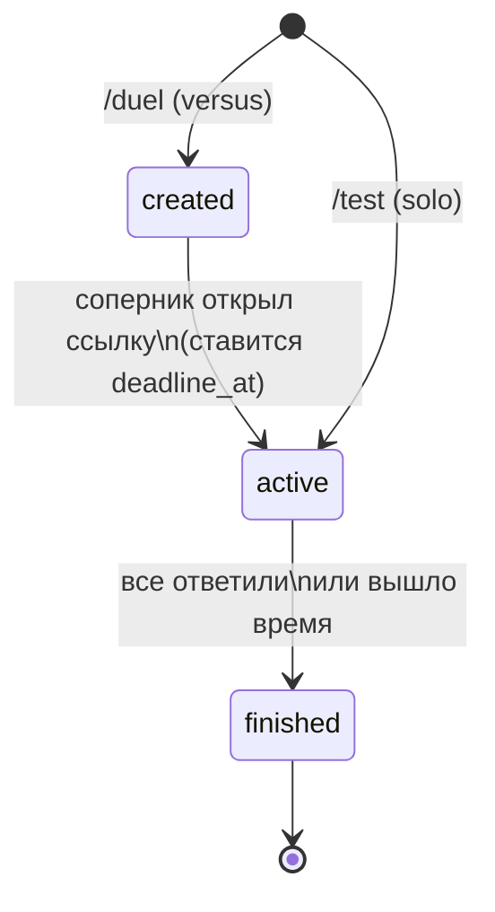

# Blind Battle (Quizzle)

Telegram-бот для асинхронных квиз-дуэлей 1 на 1. Оба игрока отвечают на одни и те же вопросы, пока не истечёт общий таймер, но **не видят ответов друг друга до конца игры**. Соперникам не нужно быть онлайн одновременно: игра стартует, когда второй игрок открывает ссылку-приглашение.

Для авторов квизов есть админ-API (сессии, CRUD квизов, публикация) и режим **тестовой игры в одиночку** прямо в боте.

## Содержание

- [Как играть](#как-играть)
- [Стек](#стек)
- [Архитектура](#архитектура)
- [Надёжность игры](#надёжность-игры)
- [База данных](#база-данных)
- [Быстрый старт](#быстрый-старт)
- [Конфигурация](#конфигурация)
- [Админ-API](#админ-api)
- [Тесты](#тесты)
- [Статус и планы](#статус-и-планы)

## Как играть

| Команда | Что делает |
|---|---|
| `/start` | Регистрация. Нужно один раз подтвердить свой номер телефона (кнопка «Поделиться номером») |
| `/duel` | Создаёт дуэль и выдаёт ссылку `t.me/<bot>?start=<token>` для соперника |
| `/start <token>` | Соперник принимает вызов, запускается общий таймер, оба получают первый вопрос |
| `/test` | Только для админов: тестовая игра в одиночку по любому квизу, в том числе неопубликованному |

Правила:

- Квиз выбирается случайно среди опубликованных; на весь квиз один таймер (`timeLimitSec`).
- В каждом вопросе ровно один верный ответ. Очки = число верных ответов; вопросы без ответа считаются неверными.
- Кто закончил раньше, ждёт соперника или конца таймера. Затем обоим приходит результат (победа, поражение, ничья).
- Тестовая игра админа не попадает в статистику и в рейтинг: у неё отдельное событие `game.solo_finished`.

## Стек

- **NestJS** (модульный монолит), TypeScript
- **PostgreSQL** + **TypeORM** (схема задаётся SQL-скриптами, `synchronize: false`)
- **Redis** + **BullMQ**: отложенная задача завершения игры по таймеру
- **nestjs-telegraf** (Telegraf): бот
- **express-session** + **argon2**: сессии и пароли админов
- **class-validator / class-transformer**, **@nestjs/swagger**
- **@nestjs/event-emitter**: события между модулями
- **Vitest** (+ SWC): юнит-тесты

Svelte-админка в планах, сейчас есть только админ-API.

## Архитектура

```
backend/src/
  common/              декораторы, фильтры, интерсепторы, TypeOrmRepository, события (common/events)
  config/
  infrastructure/      database, bullmq, cache, event (EventService), telegraf
  modules/
    admin/             админ-API: auth, admins, quiz (владелец квизов), facades, controllers
    game/              домен игры: entity, repository, service, logic, processor (BullMQ), scheduler
    user/              пользователи Telegram
    rating/            статистика
    notification/      уведомления (в разработке)
    telegram/          только транспорт: updates, listeners, keyboards, utils
    health/
```

### Жизненный цикл игры



## Надёжность игры

Источник истины по времени это колонка `deadline_at`, а не очередь. Все критичные операции атомарные:

- **Вход соперника**: один `UPDATE ... WHERE status='created' AND rival_id IS NULL AND author_id <> :user`. Нельзя занять чужую игру или сыграть с собой.
- **Приём ответа**: один `UPDATE` с `array_append` и условиями `status='active' AND deadline_at > now() AND cardinality(answers) = :questionIndex`. Двойной тап, повтор callback и ответ после дедлайна просто не проходят.
- **Завершение** идемпотентно: транзакция с `SELECT ... FOR UPDATE`, повторный вызов ничего не делает. Его вызывают три источника: последний ответ, отложенная задача BullMQ (`jobId = finish-<gameId>`) и cron-подметальщик (раз в минуту, страховка на случай падения Redis или рестарта).
- **События** отправляются после коммита.

## База данных

Схема создаётся SQL-скриптами из `docker-entrypoint-initdb.d` при первом старте контейнера Postgres:

| Скрипт | Содержимое |
|---|---|
| `01-init.sql` | Таблицы, enum-типы, индексы, триггер `updated_at` |
| `02-base-data.sql` | Дефолтный админ `admin` (пароль в комментарии скрипта). **Сменить сразу**, не использовать вне dev |
| `03-quiz-data.sql` | Два демо-квиза (TypeScript, Postgres) |
| `04-solo-and-cleanup.sql` | Режим `solo`, `is_sent`, CHECK-ограничения, индексы. Идемпотентный |

Таблицы: `admins`, `users`, `quizzes`, `games`, `notifications`, `statistic_users`, `statistic_games`.

Важно: скрипты из `initdb.d` выполняются только на **пустом томе**. На существующей базе новые скрипты применяются вручную:

```bash
docker compose exec -T postgres psql -U <user> -d <db> < 04-solo-and-cleanup.sql
```

Сущности подключаются по маске `**/*.entity.{ts,js}` в конфиге подключения.

## Быстрый старт

Требования: Node.js, Docker (Postgres и Redis).

```bash
# 1. зависимости
cd backend
npm install

# 2. Postgres и Redis (compose в корне репозитория; схема создастся скриптами initdb.d)
docker compose up -d

# 3. переменные окружения
cp .env.example .env     # заполнить, см. ниже

# 4. запуск
npm run start:dev
```

После старта:

- Swagger: `http://localhost:<порт>/api/docs` (JSON: `api/docs/json`), включён только вне production
- Бот работает через long polling: напиши ему `/start`

## Конфигурация

Пример `.env` (имена сверь с `src/config`):

```env
# приложение
PORT=3000
NODE_ENV=development
SESSION_SECRET=change-me

# Postgres
DB_HOST=localhost
DB_PORT=5432
DB_USER=
DB_PASSWORD=
DB_NAME=

# Redis (BullMQ)
BULLMQ_HOST=localhost
BULLMQ_PORT=6379

# Telegram
TELEGRAM_TOKEN=

# Telegram ID админов через _: им доступна команда /test
ADMINS_IDS=123456789_98765454321
```

Админ должен хотя бы раз написать боту `/start`, чтобы `/test` заработал. Свой Telegram ID можно узнать у любого бота-«userinfo».

## Админ-API

Авторизация по сессионной cookie: сначала `POST /admin/login`, дальше браузер отправляет cookie сам. 
Все ответы приходят в конверте `{ status, data, timestamp, query }`, 
ошибки в виде `{ status, errors: { message, details }, timestamp, path }`.

| Метод | Путь | Описание |
|---|---|---|
| `POST` | `/admin/login` | Вход (публичный) |
| `POST` | `/admin/logout` | Выход |
| `GET` | `/admin/me` | Текущий админ |
| `PATCH` | `/admin/upd-pass` | Смена пароля |
| `POST` | `/admin/new-admin` | Создать админа |
| `POST` | `/quiz` | Создать квиз (создаётся неопубликованным) |
| `GET` | `/quiz/all?page=&limit=` | Список с пагинацией |
| `GET` | `/quiz/:id` | Квиз по ID |
| `PATCH` | `/quiz/:id` | Изменить title и/или content |
| `PATCH` | `/quiz/:id/publish` | Опубликовать или скрыть |

Формат квиза:

```json
{
  "title": "Postgres для разработчика",
  "content": {
    "timeLimitSec": 90,
    "questions": [
      {
        "question": "Какой тип хранит JSON в бинарном виде?",
        "buttons": [
          { "text": "json", "isCorrectAnswer": false },
          { "text": "jsonb", "isCorrectAnswer": true }
        ]
      }
    ]
  }
}
```

Ограничения: 1–30 вопросов, 2–4 кнопки, `timeLimitSec` от 10 до 3600, в каждом вопросе ровно один верный ответ.

## Тесты

```bash
npx vitest run                  # все тесты
npx vitest run src/modules/game # один модуль
```

Сейчас это юнит-тесты без БД: 
сервисы `admin` и `quiz`, чистая логика `game` (подсчёт, победитель, готовность), рендер и разбор данных в `telegram`. 

Тесты лежат рядом с модулями: `modules/<module>/tests/*.spec.ts`.

## Статус и планы

Готово: админ-API с Swagger, дуэли, тестовый solo-режим, таймеры и подметальщик, бот.

В планах:

- Слушатель `rating`: обновление `statistic_users` и `statistic_games` по `game.finished` (`INSERT ... ON CONFLICT`), затем ELO и лидерборд
- Воркеры уведомлений и напоминания сопернику («buddy system»)
- Svelte-админка (редактор вопросов, аналитика сложности)
- Интеграционные тесты на реальном Postgres (двойной тап, ответ после дедлайна, гонка завершения)

Известные ограничения MVP:

- Токен приглашения теряется, если игрок открыл ссылку до подтверждения номера: после подтверждения нужно открыть ссылку ещё раз
- Событие `game.finished` уходит после коммита; при падении процесса ровно между ними статистика игры не обновится (решение: outbox)
- Ничья при равном счёте не разрешается по скорости ответов: время ответов не хранится
- Игры в статусе `created`, к которым никто не присоединился, не удаляются
